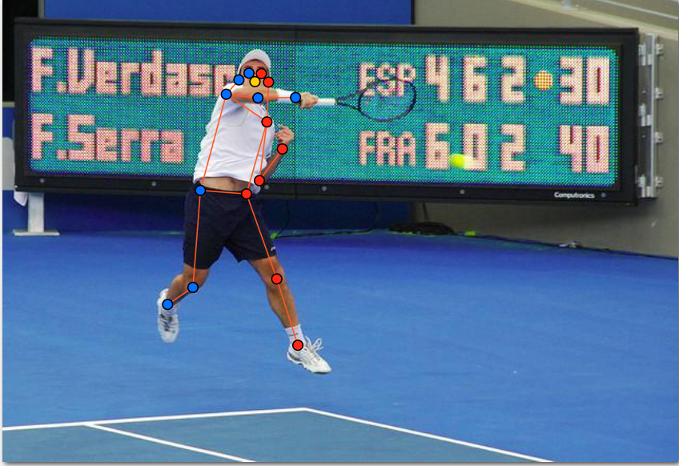
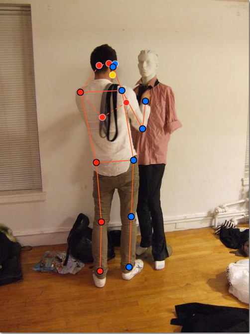
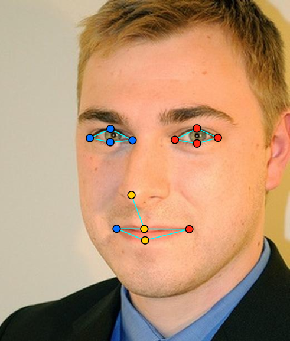
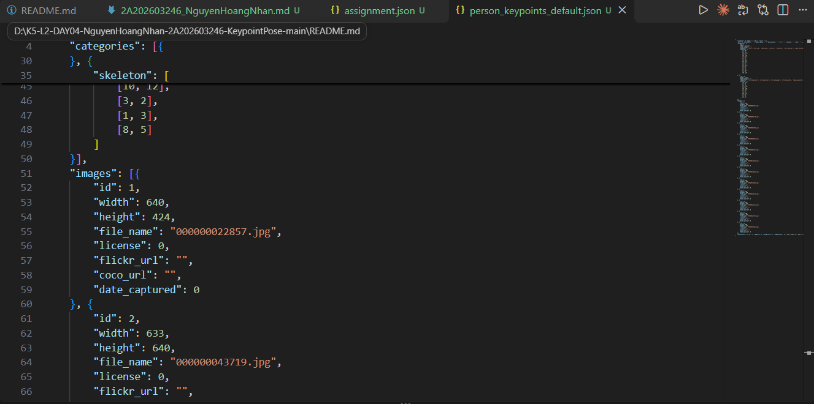

# Báo cáo cá nhân — HoVaTen-MSSV

Đổi tên file theo quy tắc `MSSV_HoTen.md`. Ví dụ: `20241234_NguyenVanAn.md`.

Dữ liệu: 12 ảnh người COCO val2017 (Lin et al., 2014) và 8 ảnh chân dung Wikimedia Commons, chỉ dùng trong lớp.

## 0. Thông tin học viên

- Họ tên: Nguyễn Hoàng Nhân
- MSSV: 2A202603246
- Email: anh359074@gmail.com
- Link repository: https://github.com/VinUni-AI20k/K5-L2-KeypointPose-Student
- Phiên bản CVAT (Help → About): cvat bình thường thui
- Máy: hệ điều hành WINDOWS· RAM 8 GB · chạy CVAT chế độ đầy đủ 
- Bộ ảnh (`src/exports/assignment.json` do `lab.py setup` tạo): có 
- Giờ bắt đầu: 4h30 ngày 12/11/2026
- Giờ kết thúc: 11h30 ngày 13/11/2026

## 1. Kiểm tra label (CP0)

| Label | Kiểu | Số điểm | Tên điểm đúng bảng của lab? | Đúng thứ tự? | Số cạnh |
|---|---|---:|---|---|---:|

| `person` | Skeleton | 17 | Đúng | Đúng | 19 |
| `face` | Skeleton | 13 | Đúng | Đúng | 13 |

Mẫu `person` dựng theo người quay mặt về camera (các điểm `left_*` nằm bên phải khung mẫu)?
Có. Trong khung mẫu, left_shoulder nằm bên phải right_shoulder.

Cách đổi cờ `occluded` / `outside` cho **một điểm** trên phiên bản CVAT này (một câu):

Rê chuột vào đúng điểm đó rồi bấm Q để đặt occluded (v = 1) hoặc O để đặt outside (v = 0); cũng có thể bấm chuột phải vào điểm để chọn trong menu, và bấm lại phím lần nữa là tắt cờ.

## 2. Số lượng đã gán và thời gian (CP1, CP2)

| Nhóm ảnh | Số ảnh | Số skeleton đã gán | Số người dưới 60 px (không gán) | Số poster / gương / màn hình bỏ qua | Thời gian (phút) |
|---|---:|---:|---:|---:|---:|
| `easy` | 5 | 6 | 0 | 0 | 20 |
| `occluded` | 3 | 5 | 0 | 0 | 30 |
| `back` | 2 | 3 | 0 | 0 | 20 |
| `small` | 1 | 2 | 1 | 0 | 10 |
| `crowd` | 1 | 3 | 2 | 0 | 25 |
| `faces` | 8 | 8 | — | 0 | 35 |

- Số ảnh người đã xong ở mốc phút 105: 10 / 10
- Thời gian thực tế (phút): CP1 105 · CP2 35 · CP3 25
- Ảnh tốn thời gian nhất là ảnh nào, vì sao?

Ảnh nhóm `crowd` (`000000309169.jpg`, 3 người) tốn thời gian nhất vì các người đứng chồng lên nhau, chân bước chéo và bị che nhiều, phải phóng to từng vùng để xác định khớp nào thuộc người nào và đâu là bên trái/phải theo người trong ảnh. Ảnh `000000122199.jpg` cũng mất thời gian vì cánh tay trái nằm ngoài cạnh phải ảnh nên phải cân nhắc kỹ giữa `v = 0` và `v = 1`.

## 3. Bảng ca khó (CP1, CP2)

Mỗi điểm bạn phân vân một dòng, nhất là phân vân giữa `v = 1` và `v = 0`, hoặc không chắc hướng người.

| Ảnh | Người / mặt | Điểm | Cờ đã chọn | Phân vân giữa | Lý do chọn |
|---|---|---|---:|---|---|
| `000000022857.jpg` | Người #1 | `left_ankle`, `right_ankle` | 0 | `v = 0` và `v = 1` | Hai cổ chân nằm dưới đáy ảnh (ảnh cao 424 px), không còn trong khung hình nên đặt `outside` (`v = 0`) thay vì đoán vị trí. |
| `000000122199.jpg` | Người #1 | `left_shoulder`, `left_elbow`, `left_wrist` | 0 | `v = 0` và `v = 1` | Cả cánh tay trái vượt ra ngoài cạnh phải ảnh (x > 480); khớp không nằm trong ảnh nên chọn `v = 0`, không đặt `v = 1`. |
| `face_309728.jpg` | Mặt #1 | 8 điểm hai mắt | 1 | `v = 1` và `v = 0` | Đeo kính râm che mắt nhưng vẫn xác định được tâm mắt nhờ gọng kính, sống mũi và lông mày nên chọn `v = 1`. |
| `000000309169.jpg` | Người #1 | `left_knee`, `left_ankle`, `right_knee`, `right_ankle` | 2 | Không chắc hướng trái/phải | Script cảnh báo cặp knee/ankle nằm ngược phía; kiểm tra lại thì người đang bước chéo chân, bên trái giải phẫu của người nằm ở phía phải ảnh khi quay mặt nên giữ nguyên. |

## 4. Bảng tự review (CP3)

Đi từ ảnh cuối về ảnh đầu. 5 ảnh người (ít nhất 2 ảnh `back` hoặc `crowd`) và 3 ảnh mặt. Ít nhất 8 dòng, kể cả dòng `ok`. Ghi lỗi trước, sửa sau.

Mã lỗi dùng đúng một trong: `lr_swap`, `vis_flag`, `position`, `missing`, `extra`, `ok`.

| Ảnh | Người / mặt | Điểm | Mã lỗi | Ghi chú | Đã sửa? |
|---|---|---|---|---|---|
| `000000309169.jpg` | Người #1 (crowd) | `left_hip`, `right_hip` | `lr_swap` | Người quay lưng, lúc đầu gán hông theo góc nhìn camera nên trái/phải bị đảo. | Đã sửa |
| `000000294379.jpg` | Người #2 | `right_knee`, `right_ankle` | `missing` | Người ở xa, chân phải bị che nhưng vẫn ước lượng được; lúc đầu bỏ sót hai điểm này. | Đã sửa |
| `000000225138.jpg` | Người #1 | `left_ankle`, `right_ankle` | `ok` | Hai chân bắt chéo nên tọa độ X đảo chiều; đã đối chiếu giải phẫu, gán đúng. | Không cần sửa |
| `000000122199.jpg` | Người #1 | `left_shoulder`, `left_elbow`, `left_wrist` | `vis_flag` | Ba điểm nằm ngoài cạnh phải ảnh nhưng ban đầu để `v = 1`; đổi sang `outside` (`v = 0`). | Đã sửa |
| `000000043968.jpg` | Người #1 | `nose` | `position` | Điểm mũi hơi lệch lên trán, kéo về chóp mũi. | Đã sửa |
| `face_309728.jpg` | Mặt #1 | 8 điểm hai mắt | `ok` | Kính râm che mắt, các điểm mắt đặt `v = 1`, năm điểm còn lại `v = 2`. | Không cần sửa |
| `face_159828.jpg` | Mặt #1 | `mouth_left`, `mouth_right` | `ok` | Đúng thứ tự khóe miệng trái/phải theo người trong ảnh. | Không cần sửa |
| `face_122747.jpg` | Mặt #1 | Toàn bộ 13 điểm | `ok` | Mặt rõ nét, các điểm khớp tâm mắt, đầu mũi và khóe miệng. | Không cần sửa |

Tổng hợp số lỗi theo mã:

| `lr_swap` | `vis_flag` | `position` | `missing` | `extra` | `ok` |
|---:|---:|---:|---:|---:|---:|
| 1 | 1 | 1 | 1 | 0 | 4 |

Điểm còn phân vân giữa `v = 1` và `v = 0` (ghi cả hai lựa chọn và lý do chọn):

Ở cánh tay trái của người #1 trong `000000122199.jpg`: chọn `v = 1` thì model học được ngữ cảnh cánh tay còn tiếp tục ra ngoài ảnh, nhưng vị trí đó chỉ là đoán và nằm ngoài khung hình; chọn `v = 0` thì mất thông tin ngữ cảnh nhưng nhãn sạch. Cuối cùng chọn `v = 0` vì khớp không thể nhìn thấy trong ảnh, không có cơ sở để ước lượng chắc chắn.

## 5. Kiểm file xuất và kết quả tự kiểm (CP4)

Tự kiểm tay trong file JSON:

| File | Người / mặt kiểm (ảnh, thứ tự) | Số phần tử `keypoints` | Điểm `outside` ra `v = 0`, `occluded` ra `v = 1`? | `num_keypoints` khớp? |
|---|---|---:|---|---|
| `NguyenHoangNhan.zip` | 000000022857.jpg, người 1 | 51 | Có: left_ankle, right_ankle nằm dưới đáy ảnh (cao 424 px) ra v = 0; các điểm bị che ra v = 1 | Khớp: 15 = 17 − 2 |
| `NguyenHoangNhan.zip` | 000000122199.jpg, người 1 | 51 | Có: left_shoulder, left_elbow, left_wrist có x > 480 (ngoài cạnh phải ảnh) ra v = 0 | Khớp: 14 = 17 − 3 |
| `NguyenHoangNhan.zip` | face_309728.jpg (kính râm) | 39 | Có: 8 điểm hai mắt ra v = 1, 5 điểm còn lại v = 2 | Khớp: 13 |

Sau khi xuất, CVAT ghi occluded thành v = 1 và outside thành v = 0. Tọa độ của điểm outside trong file là tọa độ cũ, không phải 0, 0 (ví dụ left_ankle của người 1 ở ảnh 000000022857.jpg vẫn là khoảng 157.7, 487.0). Đây là cách CVAT 2.x xuất, điểm v = 0 không được dùng khi huấn luyện hay chấm.

Hai job đã chuyển sang completed trên CVAT? Có

Dán phần **TÓM TẮT** in ra từ `src/check_submission.py`:

```text
----- TÓM TẮT (dán vào báo cáo mục 5) -----
- File person: NguyenHoangNhan_persons.zip
  Số ảnh: 12 · số skeleton `person`: 19 · mỗi annotation 51 số
  Skeleton theo ảnh: 000000022857=2, 000000043719=1, 000000043968=1, 000000090646=1, 000000091637=2, 000000122199=2, 000000150192=2, 000000156069=1, 000000225138=1, 000000261732=1, 000000294379=2, 000000309169=3
  Cờ v: v=2 207 (64%) · v=1 101 (31%) · v=0 15 (5%)
  num_keypoints trung bình: 16.2
- File face: NguyenHoangNhan_faces.zip
  Số ảnh: 8 · số skeleton `face`: 8 · mỗi annotation 39 số
  Skeleton theo ảnh: face_122747=1, face_159828=1, face_309728=1, face_416730=1, face_469647=1, face_53580=1, face_556064=1, face_85624=1
  Cờ v: v=2 93 (89%) · v=1 11 (11%) · v=0 0 (0%)
  num_keypoints trung bình: 13.0
- Ghi chú: 15 điểm v = 0 vẫn mang tọa độ cũ (CVAT 2.x xuất như vậy; chuẩn COCO ghi 0, 0). Không phải lỗi: điểm v = 0 bị bỏ qua khi huấn luyện và khi chấm.
- Số [LỖI]: 0 · số [CẢNH BÁO]: 6
Kết quả: ĐẠT (đọc lại từng cảnh báo ở trên)
```

Các `[CẢNH BÁO]` còn giữ nguyên và lý do:

| Cảnh báo của script | Giữ nguyên hay đã sửa? Vì sao? |
|---|---|
| `000000022857.jpg` #2: left_shoulder v = 2 nằm sát mép ảnh (0, 129) | Giữ nguyên. Người bị cắt ở mép trái nhưng vai trái vẫn nhìn thấy rõ ngay sát mép (x = 0 vẫn nằm trong ảnh), nên giữ `v = 2`. |
| `000000043968.jpg` #1: cặp hip, knee, ankle nằm ngược phía so với các cặp còn lại | Giữ nguyên. Người đứng nghiêng/bước chéo chân; đã đối chiếu giải phẫu theo người trong ảnh và thấy trái/phải đúng. |
| `000000122199.jpg` #2: cặp knee nằm ngược phía | Giữ nguyên. Hai chân đang bắt chéo khi bước nên đầu gối trái nằm phía phải đầu gối phải; không phải `lr_swap`. |
| `000000225138.jpg` #1: cặp ankle nằm ngược phía | Giữ nguyên. Hai cổ chân bắt chéo thật nên tọa độ X đảo chiều; đã kiểm tra bàn chân nào thuộc chân nào. |
| `000000294379.jpg` #2: các điểm chỉ trải cao 30 px (< 60 px) | Giữ nguyên. Người ở xa nên khoảng cách các điểm nhỏ, nhưng các khớp vẫn nhìn rõ và đã gán cẩn thận. |
| `000000309169.jpg` #1: cặp knee, ankle nằm ngược phía | Giữ nguyên. Sau khi sửa `lr_swap` ở hông, đã kiểm tra lại: người đang bước chéo chân nên knee/ankle đảo phía là đúng. |

## 6. Ảnh chụp màn hình

1. Label `person` trong label constructor (đủ 17 điểm có tên):

   

2. Một người quay lưng đã gán, cờ đã đặt:

   

3. Một khuôn mặt đã gán 13 điểm, phóng to vùng mắt:

   

4. Một đoạn JSON xuất của một người:

   

Nguồn ảnh: COCO val2017 / Wikimedia Commons.

## 7. Tự đánh giá

1. Lỗi bạn mắc nhiều nhất hôm nay, và cách bạn sẽ tránh ở dự án thật:

   Lỗi lớn nhất là nhầm trái/phải ở người quay lưng (`lr_swap`) và dễ để sót cờ `v` ở khớp ngoài ảnh hoặc bị che (`vis_flag`). Có đến 31% điểm của tôi là `v = 1`, nên nguy cơ gán sai cờ khá cao. Ở dự án thật mình sẽ: 
   1. luôn xác định hướng người trước, tự hỏi "tay trái của người này" thay vì "bên trái màn hình"; 
   2. review từ ảnh cuối về ảnh đầu, mỗi ảnh quay lưng/đông người kiểm tra thêm một lượt riêng trái/phải; 
   3. chạy script kiểm tra sớm để bắt cảnh báo trước khi gán tiếp.

2. Một quy tắc bạn đề xuất thêm vào guideline (kèm ảnh ví dụ nếu có):

   Khi hai chi bắt chéo nhau (ví dụ `000000225138.jpg`), guideline nên ghi rõ: "tọa độ trái/phải có thể đảo chiều theo trục X nhưng nhãn vẫn đúng; phải lần theo xương từ hông xuống cổ chân để xác nhận trước khi đổi". Quy tắc này giúp giảm sửa nhầm khi script cảnh báo "ngược phía".

3. Nhãn của bạn đi vào model ở đâu? Chọn một lỗi bạn đã sửa và nói nó sẽ làm model học sai thế nào (heatmap, trọng số trong loss, hay bước lật ảnh):

   Chọn lỗi `lr_swap` ở hông của người quay lưng (`000000309169.jpg`). Khi huấn luyện, ảnh bị lật ngang làm tăng dữ liệu và code phải hoán đổi cặp kênh `left_*` ↔ `right_*` theo bảng cờ. Nếu nhãn gốc đã bị đảo trái/phải, sau khi lật model nhận được cặp nhãn mâu thuẫn với các ảnh khác: heatmap của kênh `left_hip` lúc thì trúng hông trái thật, lúc thì trúng hông phải. Kết quả là model học cách "đoán theo vị trí trên màn hình" thay vì theo giải phẫu, và hay đổi trái/phải ở người quay lưng.

## 8. Khó khăn và lỗi kỹ thuật

- Máy Windows RAM 8 GB chạy CVAT bằng Docker khá nặng: trang tải chậm, khi mở nhiều job hoặc phóng to ảnh lớn thì giật, nên tôi phải đóng bớt ứng dụng khác và làm chia thành nhiều đợt (4h30 ngày 12/11 đến 11h30 ngày 13/11).
- Khó nhất là xác định đúng trái/phải ở người quay lưng và ở ảnh đông người; phải phóng to nhiều lần để theo dõi từng chi.
- Phím tắt Q (occluded) và O (outside) rất dễ bấm nhầm khi rê chuột sang điểm khác, nên sau mỗi người tôi kiểm tra lại cờ bằng bảng thuộc tính.
- Script `check_submission.py` báo 6 cảnh báo nhưng không có lỗi; tôi đã đối chiếu từng cảnh báo với ảnh gốc ở mục 5.

## Bonus (nếu làm)

Không thực hiện phần bonus (B1, B2, B3).

## 9. Tài liệu tham khảo và công cụ AI đã dùng

-	Tài liệu của lab: README.md, RULES.md, CHECKPOINTS.md, docs/GUIDELINE.md, docs/CVAT_CHEATSHEET.md, docs/COCO_KEYPOINTS.md.
-	Dữ liệu: COCO 2017 (Lin et al., 2014), giấy phép CC BY / CC BY-SA.
-	Công cụ AI: Claude (Anthropic)
